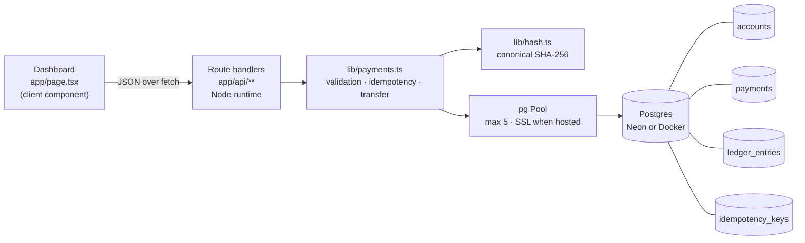

# PayLedger

**A miniature payments core that moves money exactly once, even when clients retry, servers race, and processes fail.**


|               |                                               |
| ------------- | --------------------------------------------- |
| **Live demo** | https://payledger-red.vercel.app/             |
| **Source**    | https://github.com/harshadkumarsasi/payledger |

<!-- After you add docs/payledger.gif, uncomment the next line: -->
<!--  -->

> Demo only, fake money. There is no auth, no real money, and no user management. Visitors land on a funded demo.

**Jump to:** [Try it](#try-it-in-30-seconds) · [The three guarantees](#the-three-guarantees) · [A bug my tests caught](#a-bug-my-own-tests-caught) · [API](#api) · [Run locally](#run-locally) · [Tests](#tests) · [Design decisions](#design-decisions-and-trade-offs) · [Deployment](#deployment-vercel--neon)

---

## Why this exists

Payments are easy to get subtly wrong. A user double-taps "Pay", a network retry fires twice, two requests spend the same last rupee at the same instant. PayLedger models exactly those failure modes and proves, with real concurrent requests and a real database, that they cannot corrupt the books.

It is intentionally small. The value is in the correctness properties, not in feature count.

## Try it in 30 seconds

1. Open the live demo. It is already funded with three accounts (Alice, Bob, Carol).
2. Click **Run retry storm**. It fires 20 identical payments at once with the same `Idempotency-Key`. The result: **1 created, 19 replayed**, and the money moved once.
3. Click **Run overdraft race**. It fires two simultaneous payments that each need 70% of the sender's balance. The result: **exactly one succeeds**, the other is rejected with `INSUFFICIENT_FUNDS`, and the balance never goes negative.
4. Watch the **Debits = Credits** badge stay green through all of it.

Both demos pick a funded sender (or top one up) automatically, so they work from any starting state. **Reset demo** restores the seed data.

---

## The three guarantees

| Guarantee               | What goes wrong without it                       | How PayLedger prevents it                                                                                            |
| ----------------------- | ------------------------------------------------ | -------------------------------------------------------------------------------------------------------------------- |
| **Idempotency**         | A retry or double-click creates a second payment | An `Idempotency-Key` is claimed atomically in Postgres; retries replay the stored response                           |
| **Concurrency safety**  | Two simultaneous payments overdraw one account   | Account rows are locked with `SELECT ... FOR UPDATE` before the balance is read, in a fixed order to avoid deadlocks |
| **Double-entry ledger** | Money appears or disappears with no trace        | Every payment writes one debit and one equal credit in the same transaction; balances are derived from the ledger    |

### 1. Idempotency

`POST /api/payments` requires an `Idempotency-Key` header. The request body is canonicalized (object keys sorted) and hashed with SHA-256. The hash covers only `from_account_id`, `to_account_id`, and `amount_minor`, so JSON whitespace and key order cannot make a retry look new.

Inside the payment transaction:

1. `INSERT INTO idempotency_keys ... ON CONFLICT (key) DO NOTHING RETURNING key` claims the key atomically.
2. If the insert returns a row, this request owns the key and proceeds.
3. If it returns nothing, the existing row is read:
   - different `request_hash` → **422 `IDEMPOTENCY_KEY_REUSED`**;
   - stored response present → the **exact original status and body**, plus `Idempotent-Replayed: true`;
   - no stored response yet → **409 `REQUEST_IN_PROGRESS`** (defensive; normally the unique-index conflict waits for the owner to commit, then the retry replays).
4. On success or insufficient funds, the response is written to the idempotency row **before** `COMMIT`. A retry can never observe a payment that exists without its stored answer.

A replay keeps the original status code (a replayed `201` is still `201`) and is identified by the `Idempotent-Replayed: true` header. The dashboard counts replays by that header, which is why Retry Storm reports **1 created, 19 replayed**.

The one-transaction design is what makes concurrent retries work: the primary key on `key` serializes claimants, so there is no check-then-insert window.

### 2. Concurrency safety

Before reading a balance, `lib/payments.ts` locks every non-system account involved in the transfer, **in ascending UUID order**:

```ts
const lockIds = [sender.id, receiver.id]
  .filter((id) => id !== SYSTEM_ACCOUNT_ID)
  .sort();

for (const accountId of lockIds) {
  await client.query("SELECT id FROM accounts WHERE id = $1 FOR UPDATE", [
    accountId,
  ]);
}
```

Then it computes the sender's balance from the ledger in the same transaction:

```sql
SELECT COALESCE(SUM(CASE WHEN direction = 'credit' THEN amount_minor ELSE -amount_minor END), 0)
FROM ledger_entries
WHERE account_id = $1;
```

The locks are held until `COMMIT`, so a concurrent payment touching the same account waits and then sees the first payment's ledger entries. The balance check and the inserts share one transaction, so the check cannot go stale.

The system account (`External Funding`, `is_system = true`) is exempt from locking and from the balance check. It is the source of deposits and the only account allowed to go negative; locking it would serialize every deposit for no safety benefit. A `CHECK (from_account_id <> to_account_id)` constraint backstops the application-level same-account check.

### 3. Double-entry ledger

A successful payment inserts one `payments` row and exactly two `ledger_entries` rows in the same transaction:

| Entry | Account  | Direction | Amount         |
| ----- | -------- | --------- | -------------- |
| 1     | sender   | `debit`   | `amount_minor` |
| 2     | receiver | `credit`  | `amount_minor` |

`GET /api/invariant` sums all debits and credits across the whole table. The dashboard refreshes that badge after every action and on every poll.

---

## A bug my own tests caught

While stress-testing, a simultaneous **Alice → Bob** and **Bob → Alice** transfer could deadlock. Each transaction locked its own sender row, then inserting the payment made Postgres take a key-share lock on the other account's row (for the foreign key), which the other transaction already held. Each waited on the other, and Postgres aborted one with `deadlock detected`.

**Fix:** always acquire account locks in a consistent global order (ascending UUID). With a single lock order, a circular wait is impossible. A regression test now fires 40 opposing transfers at once and asserts that none deadlock.

---

## Architecture



| Layer       | Choice                                                                                   |
| ----------- | ---------------------------------------------------------------------------------------- |
| App and API | Next.js (App Router), TypeScript in strict mode                                          |
| Database    | Postgres (Neon in production, Docker locally), plain SQL migrations, `pg` driver, no ORM |
| Validation  | zod at the boundary, plus database `CHECK` and `FOREIGN KEY` constraints                 |
| Tests       | Vitest against real Postgres                                                             |
| Hosting     | Vercel                                                                                   |

- Every route handler is `runtime = "nodejs"` and `dynamic = "force-dynamic"`.
- **`lib/payments.ts` contains all money logic**, so tests call it directly without going through HTTP.
- **Balances are never stored.** They are derived from `ledger_entries`, so a balance can never disagree with its history.

---

## Data model

Defined in [`migrations/001_init.sql`](migrations/001_init.sql).

| Table               | Purpose                              | Key constraints                                                    |
| ------------------- | ------------------------------------ | ------------------------------------------------------------------ |
| `accounts`          | Account identity and currency        | UUID PK, `is_system` flag                                          |
| `payments`          | One row per successful transfer      | UUID PK, positive amount, sender ≠ receiver                        |
| `ledger_entries`    | Append-only journal                  | `bigserial` PK, `direction IN ('debit','credit')`, positive amount |
| `idempotency_keys`  | Retry ownership and stored responses | `key` text PK, request hash, status + JSONB body                   |
| `schema_migrations` | Applied migration filenames          | Created by the migration runner                                    |

Indexes: `ledger_entries(account_id)` for balance lookups, `payments(created_at DESC)` for the feed.

The migration seeds a fixed system account, `External Funding` (`00000000-0000-4000-8000-000000000001`, `is_system = true`). Demo accounts are funded through payments from that account, so the initial state already satisfies the invariant.

---

## API

Base URL locally: `http://localhost:3000`. All responses are JSON. Money is always an integer number of **minor units (paise)**: `₹100.50` is `10050`.

Errors use one shape:

```json
{
  "error": {
    "code": "INSUFFICIENT_FUNDS",
    "message": "Insufficient funds: Alice has ₹5,000.00 available."
  }
}
```

| Method and path                  | Description                                                                                                           |
| -------------------------------- | --------------------------------------------------------------------------------------------------------------------- |
| `GET /api/accounts`              | List accounts with computed balances                                                                                  |
| `POST /api/accounts`             | Create an account `{ "name": "Dave" }` (max 20 non-system accounts, enforced with a transaction-scoped advisory lock) |
| `POST /api/accounts/:id/deposit` | Move fake money from the system account `{ "amount_minor": 25000 }` (max `100000000` per deposit)                     |
| `POST /api/payments`             | Transfer money. Requires the `Idempotency-Key` header                                                                 |
| `GET /api/payments?limit=`       | Recent payments, newest first (default 25, clamped to 1–100)                                                          |
| `GET /api/ledger?limit=`         | Recent ledger entries joined to account names (same limits)                                                           |
| `GET /api/invariant`             | `{ "total_debits": …, "total_credits": …, "balanced": true }`                                                         |
| `POST /api/demo/reset`           | Truncate everything and reseed Alice / Bob / Carol (rate limited)                                                     |

### Example: a payment and its retry

```bash
KEY=$(uuidgen)
FROM=...   # an account id from GET /api/accounts
TO=...

curl -i -s -X POST http://localhost:3000/api/payments \
  -H 'Content-Type: application/json' \
  -H "Idempotency-Key: $KEY" \
  -d "{\"from_account_id\":\"$FROM\",\"to_account_id\":\"$TO\",\"amount_minor\":12500}"
```

Run the exact same command again with the same `$KEY`: the status and body are identical, the response carries `Idempotent-Replayed: true`, and no second payment exists.

### Error codes

| Status | Code                       | Meaning                                     |
| ------ | -------------------------- | ------------------------------------------- |
| 400    | `VALIDATION_ERROR`         | Zod rejected the body or query              |
| 400    | `INVALID_JSON`             | Body was not valid JSON                     |
| 400    | `MISSING_IDEMPOTENCY_KEY`  | Payment without the required header         |
| 400    | `INVALID_IDEMPOTENCY_KEY`  | Key longer than 200 characters              |
| 400    | `CANNOT_DEPOSIT_TO_SYSTEM` | Deposit target is the system account        |
| 404    | `ACCOUNT_NOT_FOUND`        | One or both accounts do not exist           |
| 409    | `ACCOUNT_LIMIT_REACHED`    | 20 non-system accounts already exist        |
| 409    | `REQUEST_IN_PROGRESS`      | Key claimed but no response stored yet      |
| 422    | `INSUFFICIENT_FUNDS`       | Sender balance is below the amount          |
| 422    | `IDEMPOTENCY_KEY_REUSED`   | Same key, different request hash            |
| 422    | `CURRENCY_MISMATCH`        | Accounts use different currencies           |
| 429    | `RATE_LIMITED`             | Demo reset attempted too soon               |
| 500    | `INTERNAL_ERROR`           | Unexpected failure; transaction rolled back |

---

## Run locally

**Prerequisites:** Node.js 20.9+ (22 recommended), Docker with Compose.

```bash
git clone https://github.com/harshadkumarsasi/payledger.git
cd payledger
cp .env.example .env
npm install

# Starts two Postgres 17 instances:
#   dev  -> localhost:5432/payledger
#   test -> localhost:5433/payledger_test
docker compose up -d

npm run migrate
npm run seed
npm run dev
```

Open <http://localhost:3000>. The dashboard is funded and usable immediately.

`npm run seed` is destructive by design: it truncates the demo tables and recreates Alice, Bob, Carol, and the system account. **Reset demo** in the UI does the same.

### Environment variables

| Variable            | Used by                | Description                                                   |
| ------------------- | ---------------------- | ------------------------------------------------------------- |
| `DATABASE_URL`      | app, `migrate`, `seed` | Postgres connection string                                    |
| `TEST_DATABASE_URL` | Vitest                 | Dedicated test database; never the dev or production database |

`lib/db.ts` creates a lazy `Pool` (`max: 5`). SSL is enabled automatically for non-local hosts (or whenever `sslmode` requests it) and disabled for localhost.

---

## Tests

**52 automated tests across 8 files**, run against **real Postgres**, never mocks. Vitest applies pending migrations to `TEST_DATABASE_URL` before the run, and each test reseeds the demo data.

```bash
docker compose up -d
cp .env.example .env   # if you have not already
npm test

npm run typecheck
npm run lint
npm run build
```

What is covered:

**Ledger and money**

- balanced ledger after many random payments, including 200 parallel random transfers across accounts (debits equal credits, no negative balances, exactly two ledger entries per payment);
- exact balances moved, deposit path and per-deposit limit;
- integer rupee parsing and formatting edge cases.

**Idempotency**

- replay returns the identical response and creates no new rows, including replay of a stored `INSUFFICIENT_FUNDS`;
- same key with a different body returns `IDEMPOTENCY_KEY_REUSED`;
- 20 parallel identical requests create exactly one payment (1 created, 19 replayed).

**Concurrency and atomicity**

- two concurrent 70% payments: exactly one succeeds;
- 50 parallel payments from one sender whose balance covers only some of them: exactly that many succeed, and the balance never goes negative;
- simultaneous opposite-direction transfers (A → B and B → A) never deadlock;
- an injected failure after the payment insert rolls everything back, leaves the idempotency key unclaimed, and a retry then succeeds.

**Validation and demos**

- missing, empty, and over-long keys; invalid UUIDs; unknown accounts; same-account transfers; currency mismatch; zero, negative, fractional, string, null, and oversized amounts;
- account cap, name validation (including HTML strings), pagination clamping;
- both demos from a drained, tiny-balance, and freshly reset state, plus the reset rate limit.

Test files run sequentially because they share one database and truncate between tests. `tests/setup-env.ts` points `DATABASE_URL` at `TEST_DATABASE_URL`, so the app code under test can never touch the development database.

---

## Design decisions and trade-offs

### Integer minor units, never floats

Every amount is an integer number of paise: in the database (`bigint`), in JSON, in `lib/payments.ts`, and in the UI. Rupee input is parsed with string arithmetic (`parseRupeesToMinor`), and output is assembled from integer rupees and paise (`formatMinor`). `parseFloat`, `toFixed`, and floating-point division never touch money. The overdraft demo computes 70% with integer arithmetic on minor units.

### Row locking rather than optimistic retries

`SELECT ... FOR UPDATE` is simple, correct, and easy to reason about. It only serializes transfers that touch the same accounts; unrelated transfers proceed in parallel. Locking in a fixed order prevents deadlocks. Optimistic concurrency (version columns, conditional updates) would avoid blocking but needs retry loops and a stored balance, which conflicts with the computed-balance model. At much larger scale, the next step would be a ledger sharded per account with a serializable or queued write path.

### Idempotency in Postgres, not in memory

A separate `idempotency_keys` table with a primary key on `key` gives atomic ownership across processes and survives restarts. Storing the response JSON lets retries replay the exact answer, including `422 INSUFFICIENT_FUNDS`. The trade-off is unbounded growth; production would add a TTL job (for example 24 hours) and archive old keys.

### Computed balances, not cached balances

Summing the ledger on every read removes a whole class of bugs: there is no balance to drift out of sync. The index on `ledger_entries(account_id)` keeps it fast at demo scale. At high write volume, a materialized balance reconciled periodically against the ledger would be the natural optimization, with the ledger remaining the source of truth.

### Plain SQL and no ORM

The transaction boundary and the row locks are the core of the project; writing them explicitly keeps them visible and reviewable. `pg` plus SQL migrations keeps the dependency surface small.

### One transaction, exact response persistence

Claiming the key, checking accounts, locking, writing the payment and both entries, and storing the response all happen in one transaction. A crash at any point rolls everything back. The cost is holding a connection for the duration of the work, which is why the pool is capped at five per instance.

### Per-instance reset rate limit

The reset endpoint uses an in-memory timestamp. It is not a security control; it exists to stop accidental refresh loops on a public demo. A real deployment would use a shared rate limiter (for example Redis) keyed by IP or user.

---

## Deployment (Vercel + Neon)

The app is Vercel-ready: no edge runtime, no background workers, and a pooled Postgres connection string.

1. **Create a Neon project** and copy two connection strings: the **pooled** string (host contains `-pooler`) for the app, and the **direct** string for migrations.
2. **Run migrations against Neon** from your machine:

   ```bash
   DATABASE_URL='postgres://…direct…?sslmode=require' npm run migrate
   ```

3. **Import the repository into Vercel.** Framework preset: Next.js. Build command: `npm run build`. Node.js 22.x recommended.
4. **Set the function region next to the database** (for example `lhr1` for a Neon project in London), so each query stays in one region.
5. **Set the environment variable** in Vercel for Production and Preview, using the pooled URL. Never commit it:

   ```text
   DATABASE_URL=postgres://…-pooler…?sslmode=require
   ```

6. **Deploy**, then open the site and click **Reset demo** to seed the accounts (or run `npm run seed` against the direct URL).
7. Verify `GET /api/invariant` returns `"balanced": true`, then run both demos.

---

## Project structure

```text
app/
  api/
    accounts/route.ts                 # GET list, POST create
    accounts/[id]/deposit/route.ts    # POST deposit
    payments/route.ts                 # GET feed, POST transfer
    ledger/route.ts                   # GET ledger entries
    invariant/route.ts                # GET debit/credit totals
    demo/reset/route.ts               # POST truncate + reseed
  globals.css                         # Tailwind v4 theme
  layout.tsx
  page.tsx                            # dashboard (client component)
lib/
  api.ts                              # JSON response helpers
  db.ts                               # lazy pg Pool, SSL detection
  hash.ts                             # canonical request hashing
  migrations.ts                       # migration runner
  money.ts                            # integer paise parse/format
  payments.ts                         # ALL money logic
  seed.ts                             # demo data
  types.ts                            # shared API types
  validation.ts                       # zod schemas
migrations/001_init.sql
scripts/migrate.ts
scripts/seed.ts
tests/                                # real-Postgres tests
docker-compose.yml                    # dev + test Postgres
.env.example
```

---

## What I'd build next

- **Refunds and reversals** as new payments and ledger entries, never mutations of settled entries, each with its own idempotency key.
- **Webhooks with retries**: signed deliveries, exponential backoff, dead-letter handling, and replay protection.
- **Transactional outbox** so domain events are published exactly once with the payment commit.
- **Authentication and account ownership**, with per-user authorization on every account-scoped query.
- **Shared rate limiting** across instances, plus idempotency-key TTL cleanup and request quotas.
- **Observability**: structured logs with request IDs, payment latency metrics, invariant alarms, and tracing across the transfer path.
- **Pagination and statements** for payments and ledger entries, plus CSV export.
- **Multi-currency** with FX rates and per-currency ledger invariants.

---

Built by [Harshad Kumar S](https://github.com/harshadkumarsasi) · [LinkedIn](https://linkedin.com/in/harshadkumar227). A portfolio project; no real money moves.
