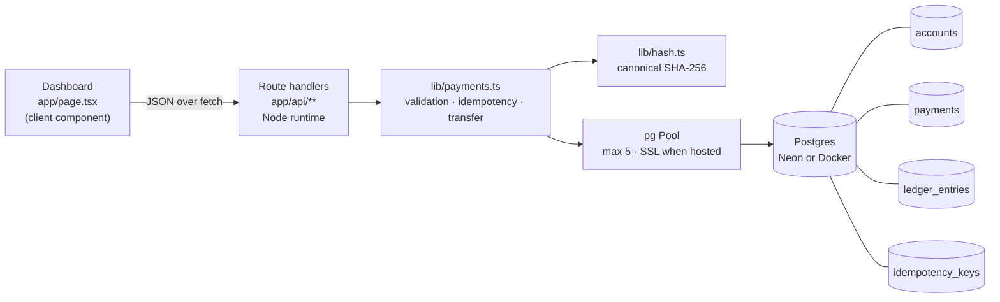

# PayLedger

A miniature payments core with three guarantees, a live demo dashboard, and an integration test suite that runs against real Postgres.

**Live demo:** _[add your Vercel URL here]_

**Demo GIF:** _[add `docs/payledger.gif` here — record a short walkthrough of the Retry Storm and Overdraft Race]_

> Demo only, fake money. There is no auth, no real money, and no user management — visitors land on a funded demo.

---

## What this is and why

PayLedger models the part of a payments system that is easy to get subtly wrong: moving money exactly once, even when clients retry, servers race, and processes fail. It is intentionally small. The value is in the correctness properties, not in feature count.

Every transfer is:

1. **Idempotent** — a retry with the same `Idempotency-Key` returns the stored response instead of creating a second payment.
2. **Concurrency-safe** — two simultaneous payments can never overdraw an account, even when both read a balance that looks large enough.
3. **Double-entry** — every payment writes exactly one debit and one equal credit. Total debits always equal total credits.

The dashboard makes those properties visible: it shows the live invariant, fires 20 identical requests in parallel, and races two 70% payments against one balance.

---

## Architecture



- **Next.js App Router** serves the dashboard and the JSON API. Every route handler is `runtime = "nodejs"` and `dynamic = "force-dynamic"`.
- **`lib/payments.ts` contains all money logic** so tests can call it directly without going through HTTP.
- **No ORM.** Migrations and queries are plain SQL with `pg`.
- **Balances are never stored.** They are derived from `ledger_entries`, so a balance can never disagree with its history.

---

## The three guarantees

### 1. Idempotency

`POST /api/payments` requires an `Idempotency-Key` header. The request body is canonicalized (object keys sorted) and hashed with SHA-256. The hash covers only `from_account_id`, `to_account_id`, and `amount_minor`, so JSON whitespace and key order cannot make a retry look new.

Inside the payment transaction:

1. `INSERT INTO idempotency_keys ... ON CONFLICT (key) DO NOTHING RETURNING key` claims the key atomically.
2. If the insert returns a row, this request owns the key and proceeds.
3. If it returns nothing, the existing row is read:
   - different `request_hash` → **422 `IDEMPOTENCY_KEY_REUSED`**;
   - stored response present → the **exact original status and body**, plus `Idempotent-Replayed: true`;
   - no stored response yet → **409 `REQUEST_IN_PROGRESS`** (defensive; normally the unique-index conflict waits for the owner to commit, then the retry replays).
4. On success or insufficient funds, the response is written to the idempotency row **before** `COMMIT`. A retry can therefore never observe a payment that exists without its stored answer.

A replay keeps the original status code — a replayed `201` is still `201` — and is identified by the `Idempotent-Replayed: true` header. The dashboard counts replays by that header, which is why the Retry Storm reports **1 created, 19 replayed**.

The one-database-transaction design is what makes concurrent retries work: the unique primary key on `key` serializes claimants. There is no check-then-insert window.

### 2. Concurrency safety

`lib/payments.ts` locks the sender row with `SELECT ... FOR UPDATE` before computing its balance:

```sql
SELECT id FROM accounts WHERE id = $1 FOR UPDATE;
SELECT COALESCE(SUM(CASE WHEN direction = 'credit' THEN amount_minor ELSE -amount_minor END), 0)
FROM ledger_entries
WHERE account_id = $1;
```

The lock is held until `COMMIT`, so a concurrent payment from the same account waits and then sees the first payment's ledger entries. The balance check and the insert are in the same transaction, so the check cannot go stale.

The system account (`External Funding`, `is_system = true`) is exempt from the lock and the balance check. It is the source of deposits and the only account allowed to go negative; locking it would serialize every deposit for no safety benefit. A `CHECK (from_account_id <> to_account_id)` constraint backstops the application-level same-account check.

### 3. Double-entry ledger

A successful payment inserts one `payments` row and exactly two `ledger_entries` rows in the same transaction:

| Entry | Account | Direction | Amount |
| --- | --- | --- | --- |
| 1 | sender | `debit` | `amount_minor` |
| 2 | receiver | `credit` | `amount_minor` |

`GET /api/invariant` sums all debits and credits across the entire table. The dashboard refreshes that badge after every action and on every poll.

---

## Data model

Defined in [`migrations/001_init.sql`](migrations/001_init.sql).

| Table | Purpose | Key constraints |
| --- | --- | --- |
| `accounts` | Account identity and currency | UUID PK, `is_system` flag |
| `payments` | One row per successful transfer | UUID PK, positive amount, sender ≠ receiver |
| `ledger_entries` | Append-only journal | `bigserial` PK, `direction IN ('debit','credit')`, positive amount |
| `idempotency_keys` | Retry ownership and stored responses | `key` text PK, request hash, status + JSONB body |
| `schema_migrations` | Applied migration filenames | Created by the migration runner |

Balances are computed:

```sql
SELECT COALESCE(SUM(CASE WHEN direction = 'credit' THEN amount_minor ELSE -amount_minor END), 0)
FROM ledger_entries
WHERE account_id = $1;
```

Indexes: `ledger_entries(account_id)` for balance lookups, `payments(created_at DESC)` for the feed.

The migration seeds a fixed system account:

- `External Funding` — `00000000-0000-4000-8000-000000000001`, `is_system = true`.

Demo accounts are seeded through funding payments from that system account, so the initial state already satisfies the invariant.

---

## API

Base URL locally: `http://localhost:3000`.

All responses are JSON. Errors use:

```json
{ "error": { "code": "INSUFFICIENT_FUNDS", "message": "Insufficient funds: Alice has ₹5,000.00 available." } }
```

Money is always an integer number of **minor units (paise)**. `₹100.50` is `10050`.

### `GET /api/accounts`

Returns every account with its computed balance.

```bash
curl -s http://localhost:3000/api/accounts | jq
```

```json
{
  "accounts": [
    {
      "id": "…",
      "name": "Alice",
      "currency": "INR",
      "is_system": false,
      "balance_minor": 500000,
      "created_at": "2026-01-01T00:00:00.000Z"
    }
  ]
}
```

### `POST /api/accounts`

Creates a non-system account. Capped at 20; concurrent creations are serialized with a transaction-scoped advisory lock.

```bash
curl -s -X POST http://localhost:3000/api/accounts \
  -H 'Content-Type: application/json' \
  -d '{"name":"Dave"}' | jq
```

`201` response: `{ "account": { … } }`.

### `POST /api/accounts/:id/deposit`

Moves fake money from the system account to the target account, using the same transfer function as a payment. Maximum **100000000** minor units (₹10,00,000) per deposit.

```bash
ACCOUNT_ID=... # from GET /api/accounts
curl -s -X POST "http://localhost:3000/api/accounts/$ACCOUNT_ID/deposit" \
  -H 'Content-Type: application/json' \
  -d '{"amount_minor":25000}' | jq
```

`201` response: `{ "payment": { … } }`.

### `POST /api/payments`

Requires `Idempotency-Key`. Returns `201` on creation, or the stored response with `Idempotent-Replayed: true` on a retry.

```bash
KEY=$(uuidgen)
FROM=...
TO=...

curl -i -s -X POST http://localhost:3000/api/payments \
  -H 'Content-Type: application/json' \
  -H "Idempotency-Key: $KEY" \
  -d "{\"from_account_id\":\"$FROM\",\"to_account_id\":\"$TO\",\"amount_minor\":12500}" | jq
```

Retry the exact same command with the same `$KEY`: the status and body are identical, the response carries `Idempotent-Replayed: true`, and no second payment exists.

Errors:

- missing header → `400 MISSING_IDEMPOTENCY_KEY`
- same key, different body → `422 IDEMPOTENCY_KEY_REUSED`
- sender cannot cover the amount → `422 INSUFFICIENT_FUNDS`
- unknown sender or receiver → `404 ACCOUNT_NOT_FOUND`

### `GET /api/payments?limit=`

Newest first. `limit` defaults to `25`, maximum `100`.

```bash
curl -s 'http://localhost:3000/api/payments?limit=10' | jq
```

### `GET /api/ledger?limit=`

Newest ledger entries, joined to account names. Same `limit` rules.

```bash
curl -s 'http://localhost:3000/api/ledger?limit=20' | jq
```

### `GET /api/invariant`

```bash
curl -s http://localhost:3000/api/invariant | jq
```

```json
{ "total_debits": 900000, "total_credits": 900000, "balanced": true }
```

### `POST /api/demo/reset`

Truncates ledger entries, payments, idempotency keys and accounts, then reseeds the system account and Alice / Bob / Carol. Limited to one reset every two seconds per server instance (`429 RATE_LIMITED`).

```bash
curl -s -X POST http://localhost:3000/api/demo/reset | jq
```

### Error codes

| Status | Code | Meaning |
| --- | --- | --- |
| 400 | `VALIDATION_ERROR` | Zod rejected the body or query |
| 400 | `INVALID_JSON` | Body was not valid JSON |
| 400 | `MISSING_IDEMPOTENCY_KEY` | Payment without the required header |
| 400 | `INVALID_IDEMPOTENCY_KEY` | Key longer than 200 characters |
| 400 | `CANNOT_DEPOSIT_TO_SYSTEM` | Deposit target is the system account |
| 404 | `ACCOUNT_NOT_FOUND` | One or both accounts do not exist |
| 409 | `ACCOUNT_LIMIT_REACHED` | 20 non-system accounts already exist |
| 409 | `REQUEST_IN_PROGRESS` | Key claimed but no response stored yet |
| 422 | `INSUFFICIENT_FUNDS` | Sender balance is below the amount |
| 422 | `IDEMPOTENCY_KEY_REUSED` | Same key, different request hash |
| 422 | `CURRENCY_MISMATCH` | Accounts use different currencies |
| 429 | `RATE_LIMITED` | Demo reset attempted too soon |
| 500 | `INTERNAL_ERROR` | Unexpected failure; transaction rolled back |

---

## Local setup

**Prerequisites:** Node.js 20.9+ (22 recommended), Docker with Compose.

```bash
git clone <your-repo-url> payledger
cd payledger
cp .env.example .env
npm install

# Starts two Postgres 17 instances:
#   dev  -> localhost:5432/payledger
#   test -> localhost:5433/payledger_test
docker compose up -d

npm run migrate
npm run seed
npm run dev
```

Open <http://localhost:3000>. The dashboard is funded and usable immediately.

`npm run seed` is destructive by design: it truncates the demo tables and recreates Alice, Bob, Carol, and the system account. Use `POST /api/demo/reset` for the same result from the UI.

### Environment variables

| Variable | Used by | Description |
| --- | --- | --- |
| `DATABASE_URL` | app, `migrate`, `seed` | Postgres connection string |
| `TEST_DATABASE_URL` | Vitest | Dedicated test database; never the dev/prod database |

`lib/db.ts` uses a `Pool` with `max: 5`. SSL is enabled automatically for non-local hosts (or whenever `sslmode` requests it) and disabled for localhost.

---

## Tests

The suite runs against **real Postgres**, never mocks. Vitest applies pending migrations to `TEST_DATABASE_URL` before the run, and each test reseeds the demo data.

```bash
docker compose up -d
cp .env.example .env   # if you have not already
npm test
```

Coverage:

- balanced ledger after many random payments, including a direct SQL sum;
- exact balances moved, exactly two ledger entries per payment;
- deposit path and per-deposit limit;
- replay returns the identical response and creates no new rows;
- same key + different body → `IDEMPOTENCY_KEY_REUSED`;
- 20 parallel identical requests → exactly one payment, 1 created + 19 replayed;
- two concurrent 70% payments → exactly one succeeds, the other gets `INSUFFICIENT_FUNDS`;
- many parallel payments from one account never overdraw;
- insufficient funds, unknown account, same-account transfer, non-positive/fractional amount, bad UUID, missing key;
- account cap, reset reseeding and rate limit;
- integer rupee parsing/formatting.

Test files run sequentially because they share one database and truncate between tests. `tests/setup-env.ts` points `DATABASE_URL` at `TEST_DATABASE_URL`, so the app code under test can never touch the development database.

```bash
npm run typecheck
npm run lint
npm run build
```

---

## Design decisions and trade-offs

### Integer minor units, never floats

Every amount is an integer number of paise — in the database (`bigint`), in JSON, in `lib/payments.ts`, and in the UI. Rupee input is parsed with string arithmetic (`parseRupeesToMinor`), and output is assembled from integer rupees and paise (`formatMinor`). `parseFloat`, `toFixed`, and floating-point division never touch money. The overdraft demo computes 70% with integer arithmetic on minor units.

### Row locking rather than optimistic retries

`SELECT ... FOR UPDATE` on the sender row is simple, correct, and easy to reason about. It serializes only transfers *from the same account*; unrelated transfers proceed in parallel. Optimistic concurrency (version columns / conditional updates) would avoid blocking but requires retry loops and a stored balance, which conflicts with the computed-balance model. At PayPal scale, a ledger with per-account sharding and a serializable or queued write path would be the next step.

### Idempotency in Postgres, not in memory

A separate `idempotency_keys` table with a primary key on `key` gives atomic ownership across processes and survives restarts. Storing the response JSON lets retries replay the exact answer, including `422 INSUFFICIENT_FUNDS`. The trade-off is unbounded growth; production would add a TTL job (e.g. 24 hours) and partition/archive old keys.

### Computed balances, not cached balances

Summing the ledger on every read removes an entire class of bugs: there is no balance to drift out of sync. The index on `ledger_entries(account_id)` keeps it fast at demo scale. At high write volume, a materialized balance with periodic reconciliation against the ledger would be the natural optimization, with the ledger remaining the source of truth.

### Plain SQL and no ORM

The transaction boundary and row lock are the core of the project; writing them explicitly makes them visible and reviewable. `pg` plus SQL migrations keeps the dependency surface small. Zod validates at the boundary, and database `CHECK`/`FOREIGN KEY` constraints provide a second line of defence.

### Single transaction, exact response persistence

Claiming the key, checking accounts, locking, writing the payment and both entries, and storing the response all happen in one transaction. A crash at any point rolls everything back. The cost is holding a connection for the duration of the work, which is why the pool is capped at five per instance.

### Per-instance reset rate limit

The reset endpoint uses an in-memory timestamp. It is deliberately not a security control — it exists to stop accidental refresh loops on a public demo. A real deployment would use a shared rate limiter (e.g. Upstash/Redis) keyed by IP or user.

---

## Deployment (Vercel + Neon)

The app is Vercel-ready: no edge runtime, no background workers, and a pooled Postgres connection string.

1. **Create a Neon project** and a database (e.g. `payledger`).
2. From Neon, copy two connection strings:
   - the **pooled** string (host contains `-pooler`) for the app;
   - the **direct** string for migrations.
3. **Run migrations against Neon** from your machine:

   ```bash
   DATABASE_URL='postgres://…direct…?sslmode=require' npm run migrate
   ```

4. **Import the repository into Vercel.** Framework preset: Next.js. Build command: `npm run build`. Node.js 22.x is recommended (Next.js requires 20.9+).
5. **Set the environment variable** in Vercel for Production and Preview:

   ```text
   DATABASE_URL=postgres://…-pooler…?sslmode=require
   ```

   Use the pooled URL here. Do not commit it to the repository.
6. **Seed the demo accounts** (required once per database, and destructive by design):

   ```bash
   DATABASE_URL='postgres://…direct…?sslmode=require' npm run seed
   ```

7. **Deploy.** The first request opens the pool and the dashboard loads the seeded accounts. Verify `GET /api/invariant` returns `"balanced": true`, then run the Retry Storm from the dashboard.

The reset rate limit is per server instance, so two Vercel instances can each allow a reset within the same two seconds. That is acceptable for a demo; see the next section for the production-grade version.

---

## Project structure

```text
app/
  api/
    accounts/route.ts                 # GET list, POST create
    accounts/[id]/deposit/route.ts    # POST deposit
    payments/route.ts                 # GET feed, POST transfer
    ledger/route.ts                   # GET ledger entries
    invariant/route.ts                # GET debit/credit totals
    demo/reset/route.ts               # POST truncate + reseed
  globals.css                         # Tailwind v4 theme
  layout.tsx
  page.tsx                            # dashboard (client component)
lib/
  api.ts                              # JSON response helpers
  db.ts                               # lazy pg Pool, SSL detection
  hash.ts                             # canonical request hashing
  migrations.ts                       # migration runner
  money.ts                            # integer paise parse/format
  payments.ts                         # ALL money logic
  seed.ts                             # demo data
  types.ts                            # shared API types
  validation.ts                       # zod schemas
migrations/001_init.sql
scripts/migrate.ts
scripts/seed.ts
tests/                                # real-Postgres integration tests
docker-compose.yml                    # dev + test Postgres
.env.example
```

---

## What I'd build next

- **Refunds and reversals** as new payments/ledger entries, never mutations of settled entries, with their own idempotency keys.
- **Webhooks with retries** — signed deliveries, exponential backoff, dead-letter handling, and replay protection.
- **Transactional outbox** so domain events are published exactly once with the payment commit.
- **Authentication and account ownership**, with per-user authorization on every account-scoped query.
- **Production rate limiting** shared across instances, plus idempotency-key TTL cleanup and request quotas.
- **Observability** — structured logs with request IDs, payment latency metrics, invariant alarms, and tracing across the transfer path.
- **Pagination and statements** for payments and ledger entries, plus CSV/OFX export.
- **Multi-currency** with FX rates and per-currency ledger invariants.

---

Built as a portfolio project; not affiliated with PayPal.
